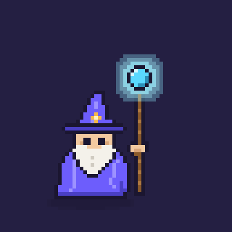
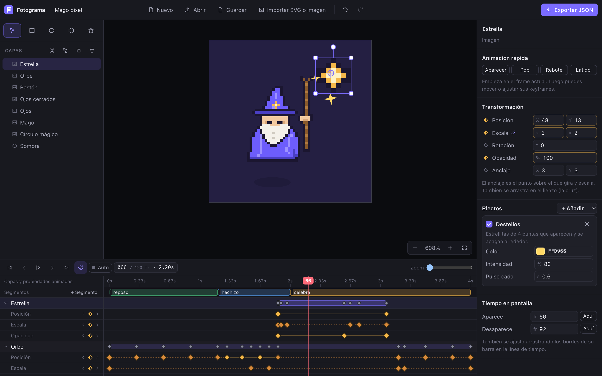
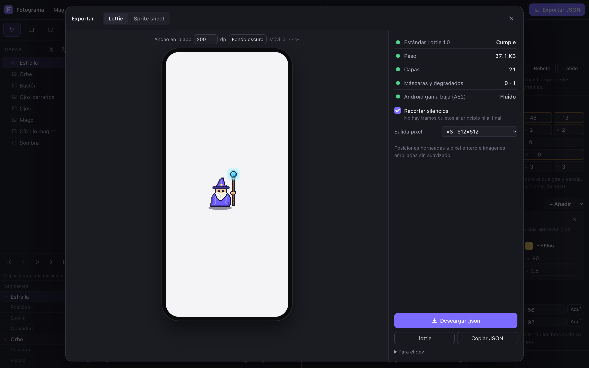

# Fotograma

[English](README.md) · [Abrir el editor](https://luigy23.github.io/fotograma/) · [Probar con el ejemplo](https://luigy23.github.io/fotograma/?ejemplo)

<p align="center"></p>

Editor de animaciones Lottie que funciona en el navegador, pensado para pixel art. Traes tu dibujo (PNG por capas o SVG de Figma), lo animas con keyframes en una línea de tiempo y exportas el JSON para la app, o una hoja de sprites. Sin cuentas ni planes de pago.



Capas a la izquierda, lienzo en el centro, propiedades a la derecha y línea de tiempo abajo, como en Lottie Creator.

## Cómo se usa

1. Trae tu dibujo.
   - PNG pixel por partes (cuerpo, ojos, orbe…): arrástralos juntos al lienzo y elige «Como capas». Si el lienzo está vacío, toma el tamaño del dibujo.
   - Secuencia fotograma a fotograma: varios PNG a la vez y «Como secuencia».
   - Desde Figma: clic derecho sobre el frame → Copiar como SVG, y aquí `⌘V`.
2. Anima. Pulsa el rombo ◇ de una propiedad (posición, escala, rotación, opacidad, color…), mueve la línea de tiempo y cambia el valor: cada cambio crea un keyframe. Con «Auto» encendido en la línea de tiempo, cualquier cambio crea su keyframe sin pulsar el rombo.
3. Para ir rápido: «Animación rápida» (Aparecer, Pop, Rebote, Latido) desde el frame actual.
4. Curvas: clic en un keyframe y elige Lineal, Suave, Entrada, Salida, Rebote leve o A saltos. Si hace falta, «Ajustar la curva a mano».
5. Efectos: en una capa, Efectos › Brillo, Brillo pixel o Destellos, con su color, intensidad y cada cuánto pulsa.
6. Segmentos: «+ Segmento» en la línea de tiempo marca tramos con nombre (reposo, pensando, celebra). Clic en uno para verlo en bucle.
7. Exportar (`⌘E`): vista previa a tamaño real dentro de un móvil, semáforo de calidad y descarga en `.json`, `.lottie` u hoja de sprites.

Guarda el proyecto con `⌘S` (`.fotograma.json`) para seguir editando otro día: el JSON exportado va optimizado y con los efectos ya convertidos, así que el que se reabre para editar es el proyecto. Mientras trabajas, todo se guarda solo en el navegador y el deshacer no tiene límite.

### Copiar y pegar

`⌘C`, `⌘X` y `⌘V` funcionan con capas y con keyframes:

- Con capas seleccionadas, copia las capas con sus imágenes y efectos y las pega encima de la seleccionada, en el mismo sitio. Sirve también entre pestañas.
- Con keyframes seleccionados, los pega desde el frame donde está la línea de tiempo, con el mismo espaciado. En la misma capa repite el movimiento; con otra capa seleccionada, se lo pasa a esa.

### Varias capas a la vez

Selecciona varias (⇧ clic o arrastrando un recuadro) y, sin agruparlas:

- las esquinas escalan el conjunto desde la esquina contraria (con `⌥`, desde el centro; con `⇧`, proporcional);
- el círculo de arriba las gira alrededor del centro del conjunto;
- en el panel derecho, posición, escala, rotación y opacidad: escribir un valor lo pone igual en todas («Mixto» si son distintas) y arrastrar la etiqueta cambia cada una desde lo que tenía. El rombo pone o quita el keyframe en todas.

### Clic derecho

En el lienzo, en las capas y en los keyframes. Desde ahí se agrupa, desagrupa, duplica, oculta, bloquea, cambia el orden y la curva. «Seleccionar» lleva a una pieza de dentro de un grupo para animarla sola, y «Separar en piezas» parte un trazo que viene unido (las letras con hueco siguen enteras).

### Modo pixel

Activado por defecto. El lienzo se mide en píxeles del dibujo y:

- las posiciones van siempre a píxel entero, también a mitad de un movimiento;
- las imágenes solo escalan ×1, ×2, ×3… y avisa si giras pixel art en ángulos que no son de 90°;
- todo se ve sin suavizado;
- al exportar a Lottie, el dibujo se amplía sin suavizado (×8, ×16…) para que se vea nítido en el móvil.

### Atajos

| Acción | Tecla |
| --- | --- |
| Seleccionar, rectángulo, elipse, polígono, estrella | `V` `R` `O` `P` `S` |
| Reproducir o pausar | `Espacio` |
| Mover el lienzo | `Espacio` + arrastrar, o la rueda |
| Zoom | `⌘` + rueda, o pellizcar |
| Frame anterior y siguiente | `,` `.` (con `⇧` de 10 en 10) |
| La capa aparece o desaparece en este frame | `⌥[` `⌥]` |
| Deshacer y rehacer | `⌘Z` `⇧⌘Z` |
| Copiar, cortar, pegar (capas o keyframes) | `⌘C` `⌘X` `⌘V` |
| Duplicar, agrupar, desagrupar | `⌘D` `⌘G` `⇧⌘G` |
| Subir o bajar capa | `⌘]` `⌘[` |
| Guardar proyecto, exportar | `⌘S` `⌘E` |

## Qué hace solo al exportar

- Quita capas ocultas, grupos vacíos, imágenes sin usar y keyframes que no cambian nada; deja estáticas las propiedades sin animación y redondea los números.
- Recorta los tramos quietos del principio y del final (se puede desactivar; muestra cómo queda).
- Hornea el pixel art: posiciones a píxel entero en cada frame y dibujo ampliado sin suavizado.
- Traduce los efectos a capas que el paquete `lottie` de Flutter dibuja bien: el Brillo es un degradado radial que pulsa, el Brillo pixel es un halo de píxeles horneado en PNG con destellos de 4 puntas, y los Destellos son formas que titilan. Nada de blur, glow de After Effects ni expresiones.
- Los segmentos salen como markers de Lottie, y en el `.json` de la hoja de sprites con su primer y último fotograma.



El semáforo de exportación revisa el peso (verde por debajo de 50 KB), las capas, máscaras y degradados, avisa si puede ir justo en un Android de gama baja (Samsung A52) y valida contra la especificación Lottie 1.0.

La hoja de sprites se genera sola: cada fotograma a la resolución del dibujo, sin suavizado, en un PNG en rejilla, más un `.json` con tamaño del fotograma, número de fotogramas, fps y segmentos. También se pueden bajar los fotogramas sueltos en un `.zip`.

## Para el dev

```dart
Lottie.asset('assets/animations/mago.json', filterQuality: FilterQuality.none)
```

Un segmento se reproduce por su nombre con `composition.getMarker('reposo')`. El `.lottie` se abre con `LottieComposition.decodeZip` eligiendo el archivo de `animations/`.

Cómo se comprobó:

- Cada exportación se valida contra el esquema oficial de Lottie 1.0 (Lottie Animation Community).
- Lo que se ve en el lienzo coincide con lo que dibuja lottie-web con el JSON final, efectos y pixel art incluidos (0 % de diferencia en las pruebas pixel, ≤ 0,01 % en vectores).
- Una animación de producción con 110 capas de imagen se abre y se vuelve a exportar sin diferencias visibles.
- `lottie` 3.3.2 de Flutter lee sin avisos los archivos de prueba: capas enlazadas, capa de escala, keyframes a saltos, degradados, markers y `.lottie`.

## Lo que aún no hace

- Abrir precomposiciones y capas emparentadas hechas en After Effects (avisa y abre lo demás).
- Editar los puntos de un trazo (pluma) o animar el cambio de forma.
- Textos y máscaras. Los degradados de un SVG entran con su primer color.

## Licencia

MIT. Ver [LICENSE](LICENSE).

## Desarrollo

```bash
npm install
npm run dev      # http://localhost:5173
npm test         # modelo, exportación, importación y optimizaciones
npm run build    # web estática en dist/
```

React, TypeScript y Vite. La lógica está separada de la interfaz:

- `src/model`: documento, keyframes y curvas, geometría con el mismo orden de vértices que lottie-web, matrices y efectos.
- `src/io`: exportar e importar Lottie, importar SVG, optimizar antes de exportar, rasterizar (halos, sprites) y validar.
- `src/store`: estado con deshacer, acciones, animaciones rápidas y horneado de halos.
- `src/ui`: lienzo, capas, inspector, línea de tiempo, menús y exportación.
- `src/examples/wizard.ts`: el ejemplo del mago, hecho en código con el pixel art escrito en texto (un carácter por píxel). Se abre con `?ejemplo` en la dirección.
- `src/dev/fidelity.ts`: comparación píxel a píxel entre el lienzo y lottie-web, para usarla desde la consola en desarrollo.
